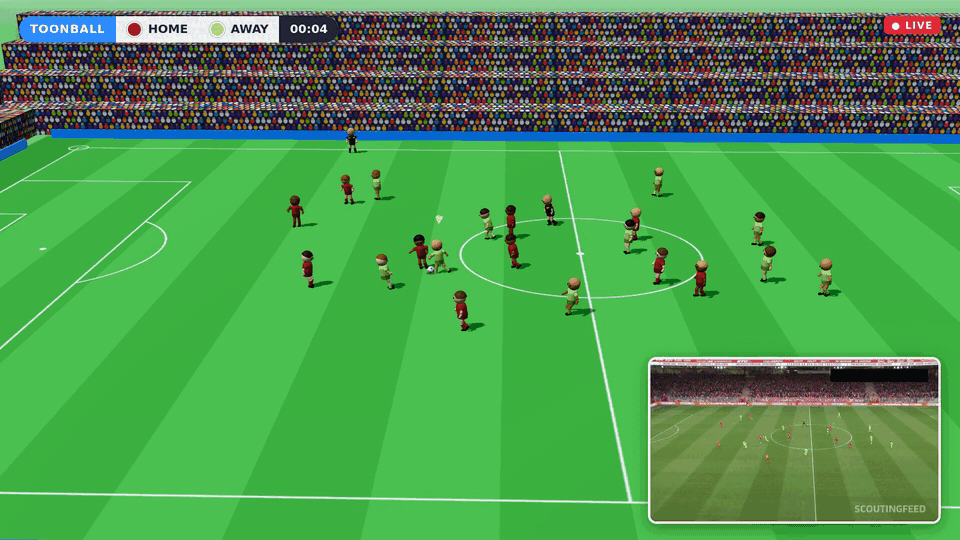
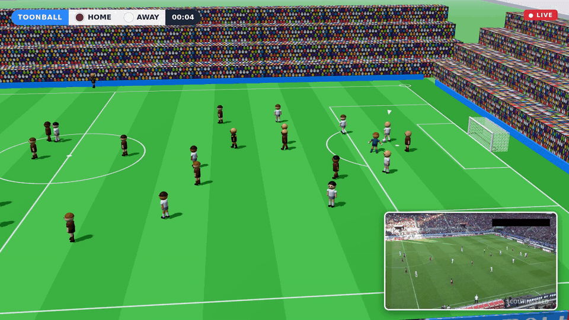
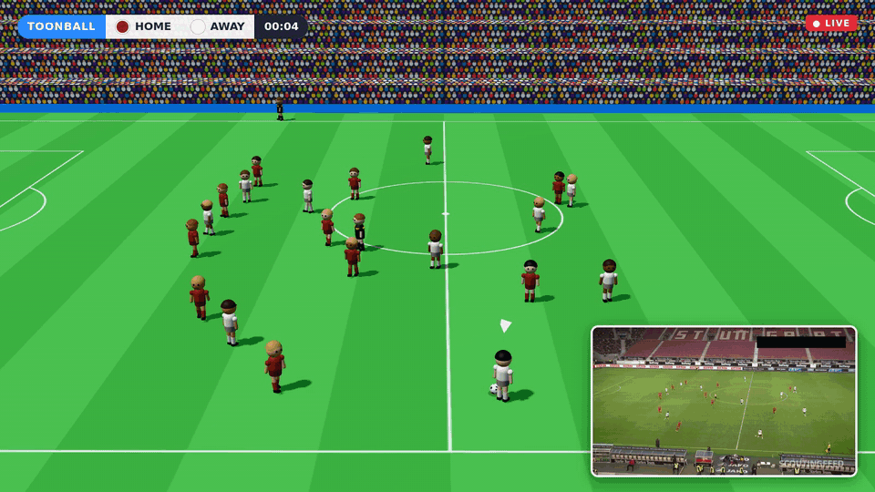
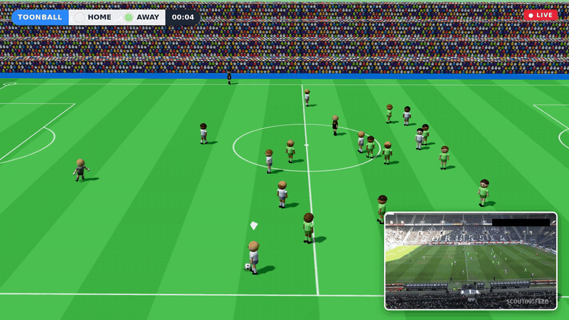
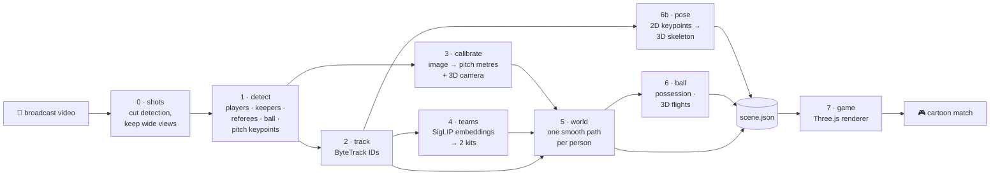

# toonball

**Turn a real football broadcast into a cartoon video-game match.**

Inspired by two broadcasts that re-skinned live sport as animation: the NFL's *Toy Story
Funday Football* (Disney+, 2023) and the Australian Open's Wii-Sports-style stream (2025).
Both were driven by tracking data from stadium-wide camera rigs. toonball recovers that tracking
from **one ordinary broadcast video** — who is where, which team, where the ball is and how high
it flies — and replays it in a Three.js game world.

<p align="center"></p>
<p align="center"></p>
<p align="center"></p>
<p align="center"></p>

Cartoon = toonball's reconstruction; bottom-right = the real broadcast it was computed from.
Full 30 s videos: [121364_0](docs/121364_0.mp4) · [573e61_0](docs/573e61_0.mp4) ·
[0bfacc_0](docs/0bfacc_0.mp4) · [08fd33_0](docs/08fd33_0.mp4)
(clips from the [DFL Bundesliga Data Shootout](https://www.kaggle.com/competitions/dfl-bundesliga-data-shootout)).

---

## How it works

Nothing is drawn on top of the video. Every stage turns the footage into **numbers in metres**,
and the game is rendered only from those numbers.



| # | Stage | What it does | How | Code |
|---|---|---|---|---|
| 0 | **Shots** | Splits the video at camera cuts and keeps only wide, calibratable shots (drops replays, close-ups, crowd, studio) | colour-histogram + pixel-difference cut detector; pitch keypoints sampled every 3rd frame | `toonball/io/shots.py` |
| 1 | **Detect** | Finds players, goalkeepers, referees, the ball and 32 pitch landmarks in every frame | YOLOv8 football models from [roboflow/sports](https://github.com/roboflow/sports); ball searched in 640 px tiles around its last position | `toonball/detect/run.py` |
| 2 | **Track** | Gives each person a persistent ID across frames | ByteTrack (supervision) | `toonball/detect/run.py` |
| 3 | **Calibrate** | Maps every pixel on the grass to metres on a 105 × 68 m pitch; recovers the full 3D camera | keypoint homographies fused with frame-to-frame camera motion (optical flow on the background) in a forward–backward filter; one fixed tripod per shot + per-frame pan/tilt/zoom | `toonball/calib/` |
| 4 | **Teams** | Splits players into the two kits and measures each kit's colour | SigLIP image embeddings of shirt crops → UMAP → k-means, majority vote per track | `toonball/team/classifier.py` |
| 5 | **World** | One smooth trajectory per real person; one goalkeeper per goal | tracklets stitched across occlusions, duplicates merged, Kalman + RTS smoothing with human acceleration limits | `toonball/track/players.py` |
| 6 | **Ball** | Who has the ball, where it goes, how high it flies | possession with hysteresis; ball at the owner's feet while dribbling; airborne passes fitted as gravity parabolas through the 3D camera | `toonball/track/ball.py` |
| 6b | **Pose** | Full-body 3D pose of every player: torso, head, arms with elbows, legs with knees | YOLO11-pose on upscaled player crops → VideoPose3D lifts each player's 2D sequence to 3D joints → rotated into pitch axes with the broadcast camera → retargeted onto the avatar's skeleton | `toonball/pose/` |
| 7 | **Game** | Renders the match as a cartoon, synced with the source video | Three.js: Mii-style or toy-figure players, procedural running / kicking / goalkeeper dives, broadcast-style follow camera | `viewer/` |

### The hard parts of doing this from one camera

| Problem | What toonball does |
|---|---|
| The pitch model sometimes labels lines that aren't on screen | Each frame's calibration is checked against the camera motion measured from the image; fits that disagree are rejected |
| A homography only knows the ground — a lofted ball looks like it is far away, not high | A rolling ball draws a **straight line** in the image, a flying ball draws a **curve**. Curved pieces that fit a gravity parabola through the 3D camera become flights (e.g. a 9 m high ball in clip 2e57b9_0) |
| The detector flips players between "player" and "goalkeeper" | Roles are decided per person, not per frame: ≥30 % keeper labels, stays near a goal, at most one per goal |
| The ball disappears behind legs | While someone has the ball it stays at their feet; gaps up to 2 s are bridged |
| A ball held by the keeper projects metres behind him on the grass | Possession is also decided in the image (ball inside a player's box); a keeper holding it high carries it in his hands |
| IDs break when players cross or leave the frame | Tracklets are stitched when the player could have run there; double tracks of one person are merged |
| Box bottoms wobble by a few pixels (= metres far from the camera) | Constant-velocity Kalman smoother whose noise grows with distance from the camera |
| The camera only sees about a third of the pitch | Players fade out at the edge of view; the game camera follows the real camera |

### Results on the demo clips

Measured by the pipeline (no ground truth involved):

| Clip | Raw track IDs → people | Keepers | Player accel. p99 (m/s²)¹ | Ball present | Ball max speed (m/s) | 3D flights (apex m) | Camera fit error (px)² |
|---|---|---|---|---|---|---|---|
| 121364_0 | 32 → 24 | 2 | 6.6 | 100 % | 45 | 1 (1.4) | 29.6 |
| 573e61_0 | 36 → 30 | 2 | 4.7 | 100 % | 28 | 0 | 20.6 |
| 0bfacc_0 | 27 → 24 | 1 | 4.9 | 100 % | 30 | 0 | 25.0 |
| 08fd33_0 | 29 → 26 | 2 | 5.6 | 100 % | 33 | 1 (3.2) | 22.6 |
| 2e57b9_0 | 36 → 29 | 3³ | 4.9 | 100 % | 38 | 3 (9.2, 5.8, 2.8) | 17.4 |

¹ Real players stay below ~6 m/s² most of the time and peak around 10.
² How well one fixed camera explains all frames; ball height is only estimated below 30 px.
³ Two keepers on the same goal at different times (a track that couldn't be joined).

---

## Quickstart

Needs an NVIDIA GPU (developed on an RTX 3060 12 GB), [uv](https://docs.astral.sh/uv/),
Node 18+ and ffmpeg.

```bash
uv sync                                       # Python env (CUDA 12.1 PyTorch wheels)
npm install && npx playwright install chromium
scripts/get_data.sh                           # demo clips → clips/, model weights → weights/

uv run toonball make clips/0bfacc_0.mp4       # any football video → cartoon video
```

Output: `runs/<video>/<video>_pip_wii.mp4`. Options:

- `--theme wii` (Mii-style players in a cartoon stadium) or `--theme toy` (plastic
  table-football figures on a rug in a kid's bedroom)
- `--layout pip` (real match bottom-right) · `side` (side by side) · `game` (cartoon only)

### Interactive viewer

```bash
uv run python -m http.server 8000
```

Then open `http://127.0.0.1:8000/viewer/index.html?run=/runs/0bfacc_0/shots/00&theme=wii&layout=pip`.
It has play / seek, and theme and layout switches.

### Commands

| Command | |
|---|---|
| `toonball make VIDEO` | Full flow for any video: shots → pipeline per shot → render → one MP4 |
| `toonball run CLIP [--start S --dur D]` | Pipeline on one continuous shot → `runs/<clip>/scene.json` |
| `toonball record RUN_DIR [--theme --layout]` | Render a run to MP4 in headless Chromium |

Every stage caches its output in `runs/<clip>/` (`people.parquet`, `homography.npy`,
`state.parquet`, `scene.json`, …), so changing the renderer or the smoothing doesn't re-run
detection.

### Speed (RTX 3060)

About 0.2 s per frame for detection (3 min for a 30 s clip), seconds for calibration and
tracking, and about 0.07 s per frame to render the video.

## Project layout

```
toonball/
  io/        shots.py (cut detection, wide-shot filter), store.py (artifact cache)
  detect/    run.py (players, ball tiles, pitch keypoints, ByteTrack, shirt crops)
  calib/     pitch.py (105×68 m model), homography.py, motion.py, camera.py
  team/      classifier.py (SigLIP → UMAP → k-means, kit colours)
  track/     players.py, ball.py, world.py
  render/    export.py (scene.json)
  cli.py     toonball make | run | record
viewer/      index.html, game.js (Three.js game world)
scripts/     get_data.sh, record.mjs (frame-by-frame capture → MP4)
tests/
```

Design notes: [PLAN.md](PLAN.md). Known issues and next steps (pose estimation, ball height on
harder footage): [FUTURE.md](FUTURE.md).

## Credits

- Detection and pitch-keypoint weights: [roboflow/sports](https://github.com/roboflow/sports)
- Demo footage: [DFL Bundesliga Data Shootout](https://www.kaggle.com/competitions/dfl-bundesliga-data-shootout)
  (Kaggle); more test clips: [football-soccer-videos-dataset](https://www.kaggle.com/datasets/shreyamainkar/football-soccer-videos-dataset)
- Built on [Ultralytics](https://github.com/ultralytics/ultralytics),
  [supervision](https://github.com/roboflow/supervision),
  [SigLIP](https://huggingface.co/google/siglip-base-patch16-224) and [three.js](https://threejs.org)
- Successor to [futstats](https://github.com/Fer14/futstats)
