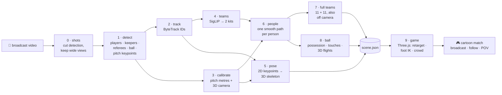

# toonball

**Turn a real football broadcast into a cartoon video-game match.**

Inspired by two broadcasts that re-skinned live sport as animation: the NFL's *Toy Story
Funday Football* (Disney+, 2023) and the Australian Open's Wii-Sports-style stream (2025).
Both were driven by tracking data from stadium-wide camera rigs. toonball recovers that tracking
from **one ordinary broadcast video**: who is where, which team, how each player's body moves,
where the ball is and how high it flies. It then replays the match in a Three.js game world
where you can follow any player, or watch through his eyes.

<p align="center"></p>

*Cartoon = toonball's reconstruction; bottom-right = the real broadcast it was computed from.*

### Click a player to follow him

<p align="center"></p>

### …or watch his point of view

<p align="center"></p>

### The whole pitch, all 22 players

The broadcast camera sees about a third of the pitch. toonball keeps the players it can't see
moving with their team (here with a 9 m lofted pass).

<p align="center"></p>

### More clips

<p align="center"></p>
<p align="center"></p>
<p align="center"></p>

Full 30 s videos:
- broadcast view: [0bfacc_0](docs/0bfacc_0.mp4) · [573e61_0](docs/573e61_0.mp4) · [121364_0](docs/121364_0.mp4) · [08fd33_0](docs/08fd33_0.mp4)
- follow the keeper: [573e61_0](docs/573e61_0_follow_keeper.mp4)
- point of view: [0bfacc_0](docs/0bfacc_0_pov.mp4)
- whole pitch: [2e57b9_0](docs/2e57b9_0_whole_pitch.mp4)

Clips are from the [DFL Bundesliga Data Shootout](https://www.kaggle.com/competitions/dfl-bundesliga-data-shootout).

---

## How it works

Nothing is drawn on top of the video. Every stage turns the footage into **numbers in metres**
(positions, a 3D skeleton per player, the ball's path), and the game is rendered only from those
numbers.



| # | Stage | What it does | How | Code |
|---|---|---|---|---|
| 0 | **Shots** | Splits the video at camera cuts and keeps only wide, calibratable shots (drops replays, close-ups, crowd, studio) | colour-histogram + pixel-difference cut detector; pitch keypoints sampled every 3rd frame | `toonball/io/shots.py` |
| 1 | **Detect** | Finds players, goalkeepers, referees, the ball and 32 pitch landmarks in every frame | YOLOv8 football models from [roboflow/sports](https://github.com/roboflow/sports); ball searched in 640 px tiles around its last position | `toonball/detect/run.py` |
| 2 | **Track** | Gives each person a persistent ID across frames | ByteTrack (supervision) | `toonball/detect/run.py` |
| 3 | **Calibrate** | Maps every pixel on the grass to metres on a 105 × 68 m pitch; recovers the full 3D camera | keypoint homographies fused with frame-to-frame camera motion (optical flow on the background) in a forward–backward filter; one fixed tripod per shot + per-frame pan / tilt / zoom | `toonball/calib/` |
| 4 | **Teams** | Splits players into the two kits and measures each kit's colour | SigLIP image embeddings of shirt crops → UMAP → k-means, majority vote per track | `toonball/team/classifier.py` |
| 5 | **Pose** | Full-body 3D skeleton (17 joints) of every player in every frame | YOLO11-pose on upscaled player crops → **MotionAGFormer** (WACV 2024) lifts each player's 2D sequence to 3D → rotated into pitch axes with the broadcast camera | `toonball/pose/` |
| 6 | **People** | One smooth trajectory per real person; roles decided per person (one keeper per goal, assistant referees, staff dropped) | tracklets stitched across occlusions, duplicates merged, Kalman + RTS smoothing with human acceleration limits | `toonball/track/players.py` |
| 7 | **Full teams** | Every team has 11 players for the whole clip, also while off camera | pieces chained into ≤ 11 identities; unseen players move with their team's centre and are kept outside the camera view; never-seen ones fill a 4-4-2 shape | `toonball/track/offscreen.py` |
| 8 | **Ball** | Who has the ball, when it leaves a player, how high it flies | possession from the image and the pitch, with hysteresis; ball at the owner's feet or in a keeper's hands; airborne passes fitted as gravity parabolas through the 3D camera | `toonball/track/ball.py` |
| 9 | **Game** | Renders the match as a cartoon, synced with the source video | Three.js. Each avatar bone is aimed at the 3D pose; a stepping cycle locked to the real footsteps with foot-planting IK; kicks, headers and throws timed to the ball; 3D crowd; follow and POV cameras | `viewer/` |

### The hard parts of doing this from one camera

| Problem | What toonball does |
|---|---|
| The pitch model sometimes labels lines that aren't on screen | Each frame's calibration is checked against the camera motion measured from the image; fits that disagree are rejected |
| A homography only knows the ground: a lofted ball looks far away, not high | A rolling ball draws a **straight line** in the image, a flying ball a **curve**. Curved pieces that fit a gravity parabola through the 3D camera become flights (a 9 m high ball in clip 2e57b9_0) |
| A ball held by the keeper projects metres behind him on the grass | Possession is also decided in the image (ball inside a player's box); a keeper holding it high carries it in his hands |
| The detector flips players between "player" and "goalkeeper" | Roles are decided per person: ≥ 30 % keeper labels, stays near a goal, at most one per goal |
| Players are 50–150 px tall: the pose model can't tell left from right leg, and lifted legs don't step cleanly | The 3D pose drives torso, head and arms (and legs when standing or kicking); while running, legs follow a stepping cycle locked to the real footsteps, with the standing foot planted by two-bone IK (sliding 2.0 → 0.4 m/s) |
| Kicks looked scripted (animation after the ball had gone) | Possessions are dated to the real first / last contact; each touch is timed so the foot, head or hands meet the ball on that frame |
| The camera only sees about a third of the pitch | Full teams: off-camera players move with their team and are never inside the shot |
| IDs break when players cross or leave the frame | Tracklets are stitched when the player could have run there; double tracks of one person are merged |
| Box bottoms wobble by a few pixels (= metres far from the camera) | Constant-velocity Kalman smoother whose noise grows with distance from the camera |

### Results on the demo clips

Measured by the pipeline (no ground truth involved):

| Clip | Players | On screen¹ | Pose-driven² | Ball touches | Ball present | Ball max speed (m/s) | 3D flights (apex m) | Camera fit (px)³ |
|---|---|---|---|---|---|---|---|---|
| 0bfacc_0 | 11 + 11 | 92 % | 85 % | 12 | 100 % | 33 | – | 25.0 |
| 573e61_0 | 11 + 11 | 94 % | 83 % | 9 | 100 % | 23 | – | 20.6 |
| 121364_0 | 11 + 11 | 94 % | 87 % | 10 | 99 % | 45 | 1 (3.4) | 29.6 |
| 08fd33_0 | 11 + 11 | 93 % | 94 % | 11 | 100 % | 33 | 1 (3.2) | 22.6 |
| 2e57b9_0 | 11 + 11 | 95 % | 84 % | 8 | 100 % | 37 | 3 (9.2, 5.3, 2.8) | 17.4 |

¹ Average share of the clip each player is detected; the rest is inferred off camera.
² Share of on-screen player-frames driven fully by the 3D pose.
³ How well one fixed camera explains all frames; ball height is only estimated below 30 px.

**Other broadcasts:** on highlight reels from other leagues (720p, tighter zooms, constant cuts) the calibration doesn't hold yet and the reconstruction is far off. See [#9](https://github.com/Fer14/toonball/issues/9).

---

## Quickstart

Needs an NVIDIA GPU (developed on an RTX 3060 12 GB), [uv](https://docs.astral.sh/uv/),
Node 18+ and ffmpeg.

```bash
uv sync                                       # Python env (CUDA 12.1 PyTorch wheels)
npm install && npx playwright install chromium
scripts/get_data.sh                           # demo clips → clips/, model weights → weights/

uv run toonball make clips/0bfacc_0.mp4       # any football video → cartoon video
```

Output: `runs/<video>/<video>_pip_wii.mp4`. Options:

- `--theme wii` (Mii-style players in a cartoon stadium) or `--theme toy` (plastic
  table-football figures on a rug in a kid's bedroom)
- `--layout pip` (real match bottom-right) · `side` (side by side) · `game` (cartoon only)
- `--no-record`: only compute `scene.json` for the interactive viewer

### Interactive viewer

```bash
uv run python -m http.server 8000
```

Then open `http://127.0.0.1:8000/viewer/index.html?run=/runs/0bfacc_0/shots/00&theme=wii&layout=pip`.

| Control | |
|---|---|
| **click a player** | follow him: chase camera, his number and team, **Follow · POV · ✕** |
| **POV** / **P** | see through his eyes |
| **✕** / **Esc** | back to the broadcast camera |
| **–** on the real match | minimise it to a tab (click the tab to bring it back) |
| bottom bar | play / seek, theme, layout, "pose from video" |

URL options:

| Option | |
|---|---|
| `theme=wii` / `toy` | Mii stadium / toy box |
| `layout=pip` / `side` / `game` | real match bottom-right / side by side / cartoon only |
| `focus=<id>` · `pov=1` | start following a player · in his POV |
| `cam=wide` | whole-pitch camera |
| `pose=0` · `plant=0` | procedural animation only · no foot locking |
| `goal=<frame>` | preview the goal celebration at that frame |

### What the cartoon shows

- **All 22 players** for the whole clip. Off camera they move with their team, never inside the shot.
- **Full-body 3D pose** from the video. Torso, head and arms always follow it, and the legs do when standing or kicking. While running, a stepping cycle locked to the real footsteps drives the legs, with the standing foot planted (no sliding).
- **Ball contact from the body:** kicks, headers, throw-ins and keeper throws happen exactly when the ball leaves the player, and the ball leaves from that foot, head or hands. A keeper holding the ball carries it in his hands.
- **Atmosphere:** shirt numbers (by position), a 3D crowd in both teams' colours that stands up when it gets dangerous near a goal, and goal celebrations.

### Commands

| Command | |
|---|---|
| `toonball make VIDEO [--no-record]` | Full flow for any video: shots → pipeline per shot → render → one MP4 |
| `toonball run CLIP [--start S --dur D]` | Pipeline on one continuous shot → `runs/<clip>/scene.json` |
| `toonball record RUN_DIR [--theme --layout]` | Render a run to MP4 in headless Chromium (`VIEW="&focus=21"` adds viewer options, `TAG=` names the file) |

Every stage caches its output in `runs/<clip>/` (`people.parquet`, `homography.npy`,
`pose.parquet`, `state.parquet`, `scene.json`, …), so changing the renderer or the smoothing
doesn't re-run detection. `TOONBALL_LIFTER=videopose3d` switches the 3D lifter back to
VideoPose3D.

### Speed (RTX 3060)

For a 30 s clip:
- detection: about 3 min (0.2 s per frame)
- 2D pose: about 1 min
- 3D lifting: about 25 s
- calibration and tracking: seconds
- rendering the video: about 0.1 s per frame

## Project layout

```
toonball/
  io/        shots.py (cut detection, wide-shot filter), store.py (artifact cache)
  detect/    run.py (players, ball tiles, pitch keypoints, ByteTrack, shirt crops)
  calib/     pitch.py (105×68 m model), homography.py, motion.py, camera.py
  team/      classifier.py (SigLIP → UMAP → k-means, kit colours)
  pose/      estimate.py (2D), lift.py (3D lifters), angles.py (gait phase), magf/ (MotionAGFormer)
  track/     players.py, offscreen.py (full teams), ball.py, world.py
  render/    export.py (scene.json)
  cli.py     toonball make | run | record
viewer/      index.html, game.js (Three.js game world)
scripts/     get_data.sh, record.mjs (frame-by-frame capture → MP4)
tests/
```

Design notes: [PLAN.md](PLAN.md). Known issues and next steps: [FUTURE.md](FUTURE.md) and
[#9](https://github.com/Fer14/toonball/issues/9).

## Credits

- Detection and pitch-keypoint weights: [roboflow/sports](https://github.com/roboflow/sports)
- 2D pose: [Ultralytics YOLO11-pose](https://github.com/ultralytics/ultralytics)
- 3D pose: [MotionAGFormer](https://github.com/TaatiTeam/MotionAGFormer) (Apache-2.0, vendored in
  `toonball/pose/magf`) and [VideoPose3D](https://github.com/facebookresearch/VideoPose3D)
- Demo footage: [DFL Bundesliga Data Shootout](https://www.kaggle.com/competitions/dfl-bundesliga-data-shootout)
  (Kaggle); more test clips: [football-soccer-videos-dataset](https://www.kaggle.com/datasets/shreyamainkar/football-soccer-videos-dataset)
- Built on [supervision](https://github.com/roboflow/supervision),
  [SigLIP](https://huggingface.co/google/siglip-base-patch16-224) and [three.js](https://threejs.org)
- Successor to [futstats](https://github.com/Fer14/futstats)
